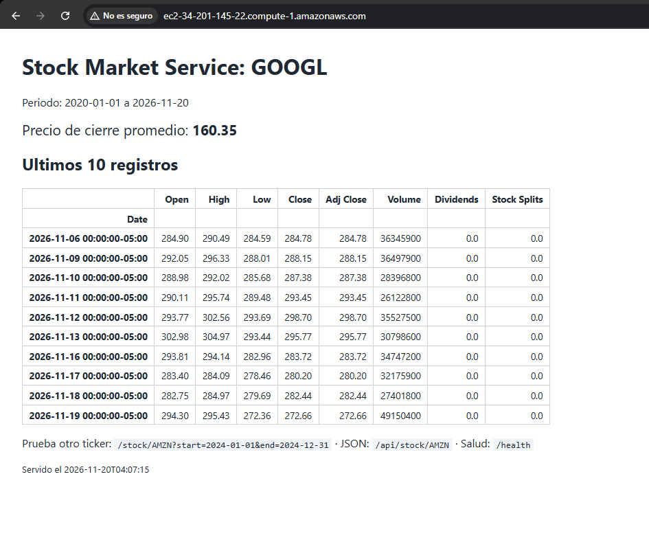
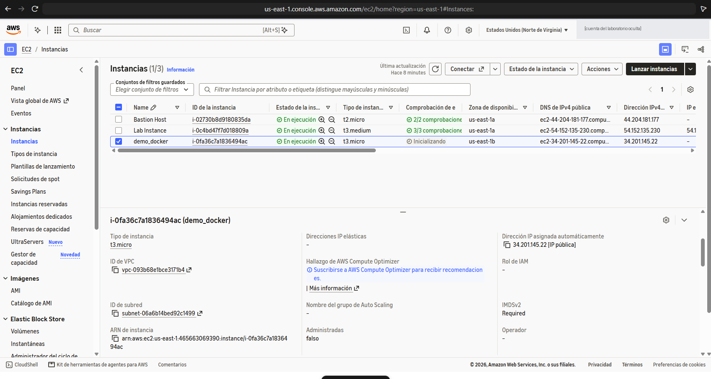

# Taller 1: Despliegue de un web service en la nube

**Computación Distribuida y Frameworks para Desarrollo de Aplicaciones Inteligentes**, Univalle.
Autor: Cristian Eduardo Morales Molina.

Este web service, hecho en Python y Flask, consulta datos bursátiles en Yahoo Finance (`yfinance`) y calcula el **precio de cierre promedio** de una acción en un periodo. Se empaqueta en Docker, se publica en Docker Hub y se despliega en una instancia EC2 de AWS.

```
Cliente (navegador) ──HTTP:80──▶ EC2 (Ubuntu + Docker) ──▶ contenedor :5000 (gunicorn + Flask) ──HTTPS──▶ Yahoo Finance
```

## Endpoints

| Ruta | Descripción |
|---|---|
| `/` | Tabla y promedio de `GOOGL` desde 2020-01-01 |
| `/stock/<ticker>?start=YYYY-MM-DD&end=YYYY-MM-DD` | Página HTML para cualquier ticker |
| `/api/stock/<ticker>?start=…&end=…` | Respuesta JSON con el número de registros, el cierre promedio y el último cierre |
| `/health` | Chequeo de salud |

## Archivos

| Archivo | Rol |
|---|---|
| `read_value_yf.py` | Lógica de acceso a datos. También se puede usar como CLI: `python read_value_yf.py AMZN` |
| `app.py` | API REST con Flask |
| `Dockerfile` | Imagen `python:3.12-slim` que corre con gunicorn y un usuario sin privilegios |
| `ec2-user-data.sh` | Script de arranque de la EC2: instala Docker y levanta el contenedor |

Mejoras frente a la guía del taller:
- Se usa **gunicorn** en lugar del servidor de desarrollo de Flask.
- El contenedor corre con un usuario **no root**.
- Se valida el ticker y las fechas, con respuestas 400 y 502.
- Las dependencias tienen versión fija.

## 1. Ejecución local

```bash
docker image build -t stock-market:2.0 .
docker container run --rm --name stock-market -p 5000:5000 stock-market:2.0
# http://localhost:5000  ·  http://localhost:5000/api/stock/AMZN
```

## 2. Publicación en Docker Hub

```bash
docker login
docker image tag stock-market:2.0 crismo24/stock-market:2.0
docker image push crismo24/stock-market:2.0
```

## 3. Despliegue en AWS EC2

La instancia se crea en el entorno **Sandbox** de AWS Academy Cloud Foundations.

1. Abrir **EC2 › Launch instance**:
   - **Name:** `demo_docker`
   - **AMI:** Ubuntu Server 24.04 LTS (elegible para la capa gratuita)
   - **Instance type:** `t2.micro` o `t3.micro`
   - **Key pair:** crear `demo_docker` (archivo `.pem`). Solo se necesita para conectarse por SSH.
   - **Network settings:** marcar *Allow SSH traffic* y *Allow HTTP traffic from the internet*.
   - **Advanced details › User data:** pegar `ec2-user-data.sh`.
2. Lanzar la instancia y esperar unos 3 minutos, mientras el script instala Docker y levanta el contenedor.
3. Copiar el **Public IPv4 DNS** y abrir `http://<public-dns>/` en el navegador. Debe ser `http`, no `https`.

> El security group abre el puerto **80**, pero Flask y gunicorn escuchan en el **5000**. Por eso el contenedor se publica con `-p 80:5000`.

Opción por AWS CLI, por ejemplo desde la terminal del Sandbox. Hace lo mismo que los pasos anteriores:

```bash
curl -fsSL https://raw.githubusercontent.com/Cristian-droi/taller1-web-service/main/deploy-ec2.sh | bash
```

Opción manual por SSH, que es el camino de la guía:

```bash
ssh -i demo_docker.pem ubuntu@<public-dns>
# Instalar Docker: https://docs.docker.com/engine/install/ubuntu/
sudo usermod -aG docker ubuntu && exit   # volver a entrar para aplicar el grupo
docker run -d --name stock-market --restart unless-stopped -p 80:5000 crismo24/stock-market:2.0
```

## 4. Apagado

**EC2 › Instances › Instance state › Terminate instance**, para no consumir créditos.

## Evidencias

| Entregable | Enlace |
|---|---|
| Código fuente y `Dockerfile` | https://github.com/Cristian-droi/taller1-web-service |
| Imagen de contenedor | https://hub.docker.com/r/crismo24/stock-market (`crismo24/stock-market:2.0`) |
| Servicio en la nube | http://ec2-34-201-145-22.compute-1.amazonaws.com/ |

El despliegue se hizo el 2026-11-19 en `us-east-1` sobre la instancia `demo_docker` (`i-0fa36c7a1836494ac`, Ubuntu 24.04, `t3.micro`). Después de tomar las evidencias, la instancia se terminó para no consumir créditos, así que la URL pública ya no responde. Las capturas dejan constancia del funcionamiento.

**Servicio respondiendo en el DNS público de la EC2.** Muestra el cierre promedio de GOOGL desde 2020-01-01 y los últimos 10 registros.



**Consola de EC2 con la instancia `demo_docker` en ejecución**, con su DNS e IP públicos.



Validación de la API desde fuera de AWS:

```bash
$ curl http://ec2-34-201-145-22.compute-1.amazonaws.com/health
{"status":"ok"}
$ curl "http://ec2-34-201-145-22.compute-1.amazonaws.com/api/stock/GOOGL?start=2024-01-01&end=2024-12-31"
{"average_close":163.71,"end":"2024-12-31","last_close":191.24,"records":251,"start":"2024-01-01","ticker":"GOOGL"}
```
